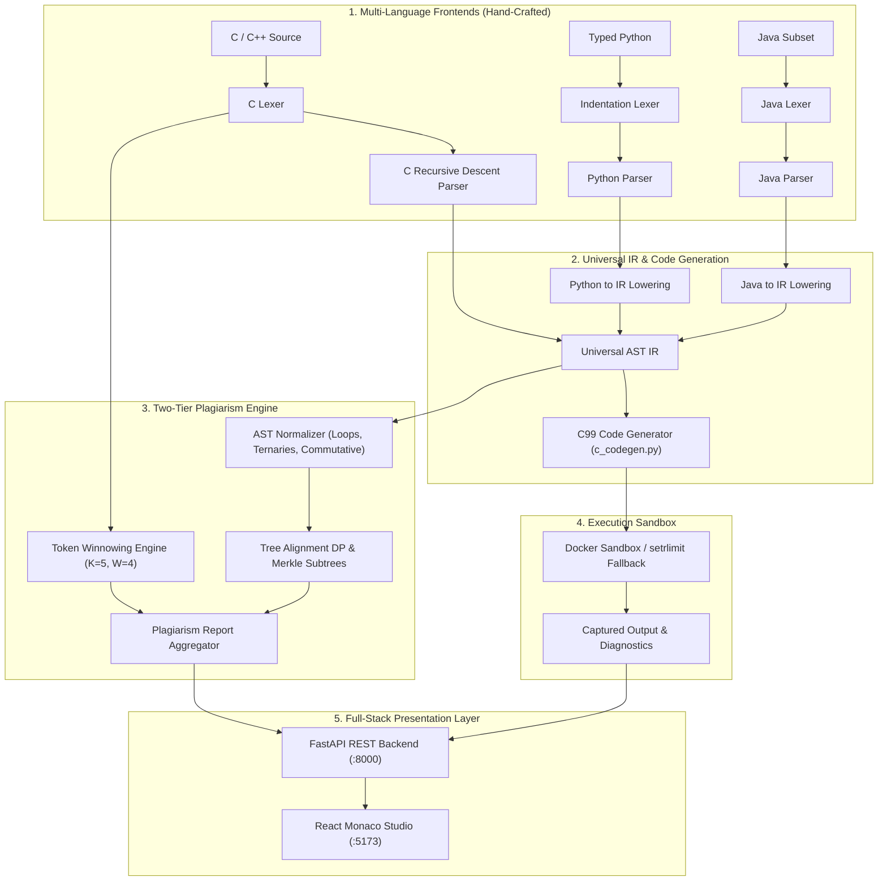

# CodeGuard 🛡️
### Multi-Language Compiler Construction & Semantic Plagiarism Detection Platform

> **A Compiler Design (CS) Capstone Project**  
> Features **hand-crafted compiler frontends** (C, C++, Typed Python, Java subset), a **source-to-source C cross-compiler**, an **isolated sandbox runner**, a **two-tier semantic plagiarism engine**, and a **full-stack web platform**.

---

## 🌟 Highlights & Key Capabilities

- **100% Hand-Crafted Compiler Pipeline**: Zero third-party parser generators or AST libraries (no ANTLR, Tree-Sitter, libclang, Python `ast`, or `javalang`). Pure recursive-descent parsers with statement-boundary error recovery.
- **Universal AST Intermediate Representation (IR)**: A unified node schema bridging C, typed Python, and Java.
- **Source-to-Source Mini Compilers**: Translates typed Python and Java subsets into ISO C99 source code with C standard library mapping and automatic type lowering.
- **Dual-Level Plagiarism Engine**:
  - **Token Level**: Winnowing algorithm with 64-bit rolling polynomial hash ($K=5, W=4$, base 257, mod $2^{61}-1$).
  - **Semantic Logic Level**: AST canonicalization (loop unification, ternary normalization, commutative operator sorting, De Morgan’s laws) paired with tree alignment dynamic programming ($O(N \cdot M)$) and deterministic Merkle subtree hashing.
- **Isolated Execution Sandbox**: Double-containment execution via Docker containers with local `resource.setrlimit` fallback (CPU timeout, 64 KB stdout truncation, memory ceiling).
- **Interactive Web Interface**: React + Vite + TypeScript + Tailwind CSS + Monaco Editor featuring a **4-stage compiler pipeline visualizer** (Tokens, Raw AST, Canonical AST, Generated C) and synchronized side-by-side diffing.

---

## ⚡ 3-Command Quickstart

Clone the repository and run:

```bash
# 1. Install dependencies
make install

# 2. Run end-to-end verification demo
make demo

# 3. Launch the full platform
# Terminal A (Backend API on :8000):
make run-backend

# Terminal B (Frontend UI on :5173):
make run-frontend
```

Alternatively, launch the complete containerized stack using Docker Compose:

```bash
docker compose up --build
```
Open [http://localhost:5173](http://localhost:5173) in your browser.

---

## 🏛️ System Architecture



---

## 🔍 In-Depth Technical Pipeline

### 1. Hand-Written Lexical Analyzers
- **C/C++ Scanner** (`backend/app/engine/lexer.py`):
  - Token stream generator with lookahead buffer.
  - Normalizes identifiers (`ID`), numeric literals (`NUM`), string literals (`STR`), character literals (`CHAR`), and preprocessor directives (`PP`).
  - Preserves exact source line and column numbers for diagnostics and highlighted diffs.
- **Python Indentation Scanner** (`backend/app/frontends/py_lexer.py`):
  - Hand-crafted indentation stack emitting synthetic `INDENT`, `DEDENT`, and `NEWLINE` tokens.
- **Java Scanner** (`backend/app/frontends/java_lexer.py`):
  - Handles Java keywords, classes, method declarations, arrays, and standard output invocations.

### 2. Recursive-Descent Syntax Parsers & Universal IR
- **C Parser** (`backend/app/engine/c_parser.py` & `c_expr_parser.py`):
  - Complete precedence-climbing expression parser handling 16 levels of C operator precedence.
  - Robust statement-boundary error recovery (synchronizes on `;` and matching `}`).
  - Tolerates basic C++ constructs (`std::cin`, `std::cout`, `using namespace std`).
- **Universal IR** (`backend/app/engine/ast_nodes.py`):
  - Unified AST node hierarchy: `FunctionDef`, `VarDecl`, `Block`, `If`, `Loop`, `Assign`, `BinaryOp`, `UnaryOp`, `Call`, `Subscript`, `Literal`, `Identifier`.

### 3. Source-to-Source Mini Compilers
- Translates Python and Java ASTs into Universal IR, which is serialized to valid ISO C99 by `c_codegen.py`:
  - Python `range(start, stop, step)` lowered to explicit C `for` loops.
  - Python `print()` and Java `System.out.println()` lowered to `printf()`.
  - Array initialization and indexed access mapped to C stack arrays.
  - Mandatory type hints (`def add(a: int, b: int) -> int:`) lowered to native C types (`int`, `float`, `char*`, `void`).

### 4. Plagiarism Detection Engine
| Level | Component | Description |
| :--- | :--- | :--- |
| **Tier 1: Token** | **Winnowing Algorithm** | Slides a $K=5$ gram window across normalized token hashes, choosing local minima over window size $W=4$. Computes Jaccard index and directional containment scores. |
| **Tier 2: Semantic** | **AST Canonicalization** | Unifies `for`, `while`, and `do-while` into a single `Loop` representation. Expands `+=`, `-=`, `++`, `--`. Flattens redundant single-statement blocks. Sorts commutative operands (`a + b == b + a`). Applies De Morgan's laws. Proved strictly idempotent ($N(N(T)) = N(T)$). |
| **Tier 2: Semantic** | **Tree Alignment DP** | Recursive bottom-up tree alignment dynamic programming measuring structural similarity ($O(N \cdot M)$). Guarded for trees $> 3000$ nodes. |
| **Tier 2: Semantic** | **Merkle Subtree Hashing** | Computes deterministic bottom-up cryptographic hashes of canonical AST subtrees to pinpoint cloned code fragments. |

---

## 📊 Benchmark Corpus & Invariant Validation

The platform was tested against an 8-problem-family benchmark corpus (32 hand-crafted source implementations across algorithms such as Factorial, Fibonacci, GCD, Prime Sieve, Bubble Sort, Binary Search, Array Sum, String Reverse).

To pass evaluation, the system must strictly satisfy the ordering invariant:
$$\text{Identical} \ge \text{Renamed} \ge \text{Restructured} > \text{Different}$$

Run the verification matrix:
```bash
make matrix
```

**Results:**
```
==========================================================================================
CODEGUARD CORPUS SIMILARITY MATRIX
==========================================================================================
Family           | Identical        | Renamed          | Restructured     | Different        | Status  
------------------------------------------------------------------------------------------
factorial        | O: 1.00 (L:1.00) | O: 0.89 (L:0.82) | O: 0.66 (L:0.99) | O: 0.16 (L:0.23) | PASS    
fibonacci        | O: 1.00 (L:1.00) | O: 0.89 (L:0.81) | O: 0.76 (L:0.97) | O: 0.51 (L:0.63) | PASS    
gcd              | O: 1.00 (L:1.00) | O: 0.88 (L:0.80) | O: 0.32 (L:0.44) | O: 0.28 (L:0.40) | PASS    
prime_check      | O: 1.00 (L:1.00) | O: 0.92 (L:0.86) | O: 0.67 (L:0.91) | O: 0.54 (L:0.67) | PASS    
bubble_sort      | O: 1.00 (L:1.00) | O: 0.89 (L:0.82) | O: 0.78 (L:0.99) | O: 0.33 (L:0.35) | PASS    
binary_search    | O: 1.00 (L:1.00) | O: 0.89 (L:0.82) | O: 0.83 (L:0.99) | O: 0.41 (L:0.54) | PASS    
array_sum        | O: 1.00 (L:1.00) | O: 0.89 (L:0.81) | O: 0.71 (L:0.99) | O: 0.42 (L:0.60) | PASS    
string_reverse   | O: 1.00 (L:1.00) | O: 0.88 (L:0.80) | O: 0.59 (L:0.76) | O: 0.29 (L:0.41) | PASS    
==========================================================================================
[SUCCESS] All 8 problem families strictly satisfy the ordering invariant!
```

---

## 🧪 Automated Test Suite

Run all 75 automated pytest unit and integration tests:

```bash
make test
```

### Coverage Overview:
- `test_lexer.py`: Operator greediness, character and string escape sequences, token coordinate accuracy.
- `test_parser.py`: Precedence climbing, complex declarations, control flow, statement error recovery, C++ tolerance.
- `test_normalize.py`: Loop canonicalization, commutative sorting, De Morgan simplification, proof of idempotence.
- `test_similarity.py`: AST tree alignment, size guards, Merkle subtree identification.
- `test_winnowing.py`: Hash determinism, whitespace insensitivity, renamed identifier robustness.
- `test_py_converter.py` & `test_java_converter.py`: Compilation and bit-for-bit execution matching reference interpreters.
- `test_sandbox.py`: Security stress tests (infinite loops, memory bombs, 64 KB stdout capping, restricted file system access).
- `test_api.py`: FastAPI endpoint integration tests.

---

## 📁 Repository Structure

```
cdproj/
├── backend/
│   ├── app/
│   │   ├── api/               # FastAPI endpoints & Pydantic schemas
│   │   ├── db/                # SQLAlchemy database & inverted fingerprint index
│   │   ├── engine/            # Core compiler & plagiarism engine
│   │   │   ├── ast_nodes.py       # Universal AST IR node hierarchy
│   │   │   ├── lexer.py           # Hand-written C/C++ scanner
│   │   │   ├── c_parser.py        # Recursive-descent statement parser
│   │   │   ├── c_expr_parser.py   # Precedence-climbing expression parser
│   │   │   ├── ast_normalize.py   # Canonicalization & equivalence engine
│   │   │   ├── ast_similarity.py  # Tree alignment DP & Merkle hashing
│   │   │   ├── winnowing.py       # Winnowing fingerprinting algorithm
│   │   │   ├── c_codegen.py       # IR to compilable C code generator
│   │   │   └── report.py          # Report aggregator & coordinate matcher
│   │   ├── frontends/         # Multi-language frontends
│   │   │   ├── py_lexer.py        # Python indentation scanner
│   │   │   ├── py_parser.py       # Typed Python recursive descent parser
│   │   │   ├── py_to_ir.py        # Python to Universal IR lowering
│   │   │   ├── java_lexer.py      # Java scanner
│   │   │   ├── java_parser.py     # Java class & method parser
│   │   │   ├── java_expr_parser.py# Java expression parser
│   │   │   ├── java_to_ir.py      # Java to Universal IR lowering
│   │   │   └── converter.py       # Unified source-to-C converter
│   │   ├── execution/         # Sandboxed execution environment
│   │   │   └── sandbox.py         # Docker / setrlimit process supervisor
│   │   ├── demo.py            # Scripted end-to-end demonstration
│   │   └── main.py            # FastAPI entry point
│   └── requirements.txt       # Python dependencies
├── frontend/                  # React 18 + TypeScript + Vite GUI
│   ├── src/
│   │   ├── components/        # Navbar, EditorView, PipelineView, ReportView, SubmissionsView
│   │   ├── services/          # API client for backend endpoints
│   │   ├── types/             # TypeScript schema interfaces
│   │   ├── App.tsx            # Root application layout
│   │   └── main.tsx           # Entry point
│   ├── package.json           # Frontend dependencies
│   └── vite.config.ts         # Vite configuration
├── docker/                    # Containerization assets
│   ├── Dockerfile.backend     # FastAPI service Dockerfile
│   ├── Dockerfile.frontend    # Production multi-stage Nginx Dockerfile
│   ├── Dockerfile.sandbox     # Alpine isolated compilation sandbox
│   └── nginx.conf             # Nginx reverse proxy configuration
├── docs/                      # Technical design & documentation
│   ├── architecture.md        # Deep architectural design document
│   └── limitations.md         # Explicit language subset specifications
├── tests/                     # 75 unit, integration, and matrix tests
│   ├── corpus/                # 8 algorithm families (32 source files)
│   └── test_*.py              # Comprehensive test suites
├── docker-compose.yml         # Container orchestration
├── Makefile                   # Developer command runner
└── README.md                  # Project documentation
```

---

## 🛠️ Make Commands Reference

| Command | Action |
| :--- | :--- |
| `make demo` | Runs the end-to-end scripted pipeline demonstration |
| `make test` | Runs the full 75-test automated pytest suite |
| `make matrix` | Executes the 8-problem-family corpus similarity matrix |
| `make run-backend` | Launches FastAPI backend on `http://localhost:8000` |
| `make run-frontend` | Launches Vite React frontend dev server on `http://localhost:5173` |
| `make build-frontend` | Builds production-optimized frontend bundle (`dist/`) |
| `make install` | Configures `.venv` and installs all Python & npm dependencies |
| `make clean` | Removes cache, bytecode, and build artifacts |

---

## 📄 License & Attribution
Designed and built for the **Compiler Design (CS) Capstone Course**.  
Authored with pride using first-principles compiler construction techniques.
