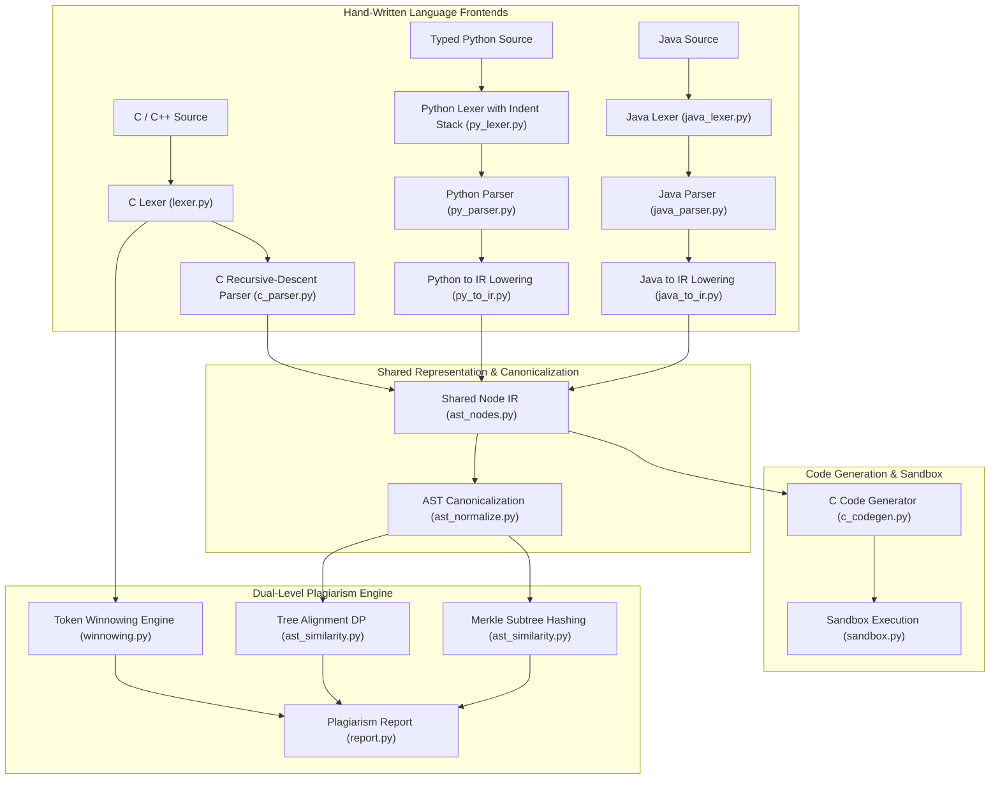

# CodeGuard Architecture Specification

CodeGuard is an end-to-end compiler construction and plagiarism detection platform built without external parser generators (no ANTLR, Tree-Sitter, libclang, or Python `ast`). All lexers, parsers, canonicalization transforms, IR representations, and code generators are hand-crafted.

---

## 1. System Architecture



---

## 2. Core Modules

| Module | Location | Responsibility |
| :--- | :--- | :--- |
| **`ast_nodes.py`** | `backend/app/engine/` | Universal AST `Node(kind, value, children, line, col)` IR. |
| **`lexer.py`** | `backend/app/engine/` | Hand-written character scanner for C/C++ with token normalization. |
| **`winnowing.py`** | `backend/app/engine/` | Process-independent FNV-1a hashing & polynomial rolling hash ($K=5, W=4$). |
| **`c_parser.py`** | `backend/app/engine/` | Recursive-descent C parser with statement-boundary error recovery & C++ tolerance. |
| **`c_expr_parser.py`** | `backend/app/engine/` | Full C expression precedence climbing and postfix/primary parsing. |
| **`ast_normalize.py`** | `backend/app/engine/` | Semantic canonicalization pass (unifies loops, desugars operators, sorts commutative ops). |
| **`ast_similarity.py`** | `backend/app/engine/` | Weighted tree alignment DP (Dice) & Merkle subtree hashing with size guard. |
| **`report.py`** | `backend/app/engine/` | Consolidated dual-level plagiarism report and verdict calculator. |
| **`py_lexer.py`** | `backend/app/frontends/` | Indentation-aware scanner emitting INDENT, DEDENT, NEWLINE tokens. |
| **`py_parser.py`** | `backend/app/frontends/` | Enforces mandatory static type hints and parses typed Python subset. |
| **`py_to_ir.py`** | `backend/app/frontends/` | Lowers typed Python into shared Node IR with local type inference. |
| **`java_lexer.py`** | `backend/app/frontends/` | Hand-written Java scanner. |
| **`java_parser.py`** | `backend/app/frontends/` | Recursive-descent Java parser isolating static methods and control flow. |
| **`java_to_ir.py`** | `backend/app/frontends/` | Translates Java static methods, `System.out.println`, and `Math` calls to C IR. |
| **`c_codegen.py`** | `backend/app/codegen/` | Pretty-prints shared IR into valid, compilable C source code. |
| **`sandbox.py`** | `backend/app/execution/` | Resource-constrained runner (Docker sandbox + local `setrlimit` fallback). |

---

## 3. Formal Grammars (EBNF Subsets)

### 3.1 C Grammar Subset
```ebnf
TranslationUnit ::= { ExternalDeclaration } ;
ExternalDeclaration ::= FunctionDef | FunctionDecl | VarDecl ;
FunctionDef ::= TypeSpecifier IDENTIFIER "(" [ ParameterList ] ")" Block ;
FunctionDecl ::= TypeSpecifier IDENTIFIER "(" [ ParameterList ] ")" ";" ;
ParameterList ::= Parameter { "," Parameter } ;
Parameter ::= TypeSpecifier [ IDENTIFIER [ "[" "]" ] ] ;
TypeSpecifier ::= { TypeQualifier } ( PrimitiveType | StructType | IDENTIFIER ) { "*" | "&" } ;
Block ::= "{" { Statement } "}" ;
Statement ::= Block
            | VarDecl
            | "if" "(" Expression ")" Statement [ "else" Statement ]
            | "while" "(" Expression ")" Statement
            | "for" "(" [ ForInit ] ";" [ Expression ] ";" [ Expression ] ")" Statement
            | "do" Statement "while" "(" Expression ")" ";"
            | "switch" "(" Expression ")" Statement
            | "case" Expression ":"
            | "default" ":"
            | "break" ";" | "continue" ";"
            | "return" [ Expression ] ";"
            | Expression ";" ;
Expression ::= AssignmentExpr ;
AssignmentExpr ::= TernaryExpr [ ( "=" | "+=" | "-=" | "*=" | "/=" | "%=" ) AssignmentExpr ] ;
TernaryExpr ::= LogicalOrExpr [ "?" Expression ":" TernaryExpr ] ;
LogicalOrExpr ::= LogicalAndExpr { "||" LogicalAndExpr } ;
LogicalAndExpr ::= BitwiseOrExpr { "&&" BitwiseOrExpr } ;
BitwiseOrExpr ::= BitwiseXorExpr { "|" BitwiseXorExpr } ;
BitwiseXorExpr ::= BitwiseAndExpr { "^" BitwiseAndExpr } ;
BitwiseAndExpr ::= EqualityExpr { "&" EqualityExpr } ;
EqualityExpr ::= RelationalExpr { ( "==" | "!=" ) RelationalExpr } ;
RelationalExpr ::= ShiftExpr { ( "<" | "<=" | ">" | ">=" ) ShiftExpr } ;
ShiftExpr ::= AdditiveExpr { ( "<<" | ">>" ) AdditiveExpr } ;
AdditiveExpr ::= MultiplicativeExpr { ( "+" | "-" ) MultiplicativeExpr } ;
MultiplicativeExpr ::= UnaryExpr { ( "*" | "/" | "%" ) UnaryExpr } ;
UnaryExpr ::= ( "++" | "--" | "+" | "-" | "!" | "~" | "*" | "&" ) UnaryExpr
            | "sizeof" ( "(" TypeSpecifier ")" | UnaryExpr )
            | "(" TypeSpecifier ")" UnaryExpr
            | PostfixExpr ;
PostfixExpr ::= PrimaryExpr { ( "++" | "--" | "(" [ ArgList ] ")" | "[" Expression "]" | "." IDENTIFIER | "->" IDENTIFIER | "::" IDENTIFIER ) } ;
PrimaryExpr ::= IDENTIFIER | NUMBER | STRING | CHAR | "(" Expression ")" ;
```

---

## 4. Canonicalization (Normalization) Rules

1. **Loop Unification**:
   - `for (init; cond; step) { body }` $\Longrightarrow$ `[init, Loop(cond, Block([body, step]))]`
   - `while (cond) { body }` $\Longrightarrow$ `Loop(cond, Block([body]))`
   - `do { body } while (cond);` $\Longrightarrow$ `Loop(cond, Block([body]))`
2. **Compound Assignments & Increments**:
   - `x += y` $\Longrightarrow$ `x = x + y` (and similar for `-=`, `*=`, `/=`, etc.)
   - `x++` / `++x` $\Longrightarrow$ `x = x + 1`
   - `x--` / `--x` $\Longrightarrow$ `x = x - 1`
3. **Control Flow Inlining**:
   - `if (c) return A; else return B;` $\Longrightarrow$ `return (c ? A : B);`
   - `if (c) v = A; else v = B;` $\Longrightarrow$ `v = (c ? A : B);`
4. **Commutative Operator Ordering**:
   - For binary operators $\odot \in \{+, *, ==, !=, \&\&, ||, \&, |, \^\}$, if `key(right) < key(left)`, swap operands to establish canonical lexicographical ordering.
5. **Boolean Negation & De Morgan**:
   - `!(a < b)` $\Longrightarrow$ `a >= b`
   - `!(a <= b)` $\Longrightarrow$ `a > b`
   - `!(a == b)` $\Longrightarrow$ `a != b`
   - `!(a && b)` $\Longrightarrow$ `!a || !b`
   - `!(a || b)` $\Longrightarrow$ `!a && !b`
   - `!!a` $\Longrightarrow$ `a`

---

## 5. Scoring Formulas

1. **Winnowing Token Similarity (Jaccard)**:
   $$\text{Sim}_{\text{token}}(A, B) = \frac{|H_A \cap H_B|}{|H_A \cup H_B|}$$
   Where $H_A, H_B$ are sets of selected minimum $K$-gram hashes ($K=5, W=4$).

2. **AST Tree Alignment (Weighted DP Dice Coefficient)**:
   $$\text{Align}(A, B) = \frac{2 \cdot \text{Matched}(A, B)}{|A| + |B|}$$
   Where node match gives $1.0$ if $\text{kind}_A = \text{kind}_B \land \text{val}_A = \text{val}_B$, and $0.5$ if $\text{kind}_A = \text{kind}_B \land \text{val}_A \ne \text{val}_B$.

3. **Merkle Maximal Subtree Coverage**:
   $$\text{Coverage}(A, B) = \frac{1}{2} \left( \frac{\sum_{M \in \mathcal{M}_A} |M|}{|A|} + \frac{\sum_{M \in \mathcal{M}_B} |M|}{|B|} \right)$$
   Where $\mathcal{M}$ is the set of maximal matching subtrees with $|M| \ge 3$.

4. **Overall Logic Similarity**:
   $$\text{Sim}_{\text{logic}}(A, B) = \max\left(\text{Align}(A, B),\, \text{Coverage}(A, B)\right)$$

5. **Consolidated Plagiarism Score**:
   $$\text{Score}_{\text{overall}} = 0.40 \cdot \text{Sim}_{\text{token}} + 0.60 \cdot \text{Sim}_{\text{logic}}$$
   - Verdict: $\ge 0.75 \implies \text{likely copied}$, $\ge 0.50 \implies \text{suspicious}$, $< 0.50 \implies \text{low}$.
