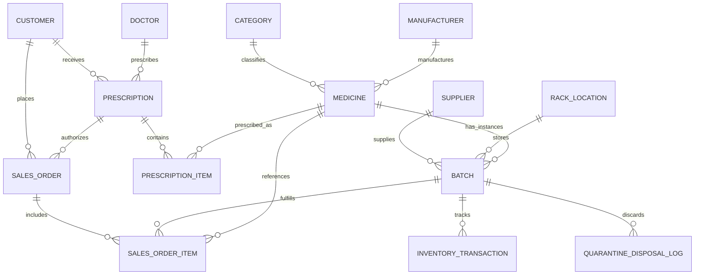

# Smart Pharmacy Inventory, Batch Tracking & Expiry Management System
**Academic DBMS Project Report & Technical Architecture Document**  
**Database Management System:** PostgreSQL 16+  
**Implementation Paradigm:** Database-Centric Architecture (PL/pgSQL Engine)

---

## 1. Executive Summary & Problem Definition

In retail pharmaceutical operations, inventory management fundamentally differs from standard FMCG retail. Drugs possess:
1. **Strict Shelf-Life Expiry**: Dispensing an expired antibiotic or chemotherapy agent poses catastrophic clinical and legal liability.
2. **Batch / Lot Numbers**: Quality defects, FDA/CDSCO recalls, and manufacturer notices require instant traceability of every single tablet back to its specific production lot, wholesale supplier, and dispensing invoice.
3. **Thermal Storage Conditions**: Vaccines and biologics (e.g., Insulin) spoil if not stored strictly between 2°C and 8°C (Cold Chain).
4. **First-Expired, First-Out (FEFO) Imperative**: Standard FIFO (First-In, First-Out) is inadequate because newer shipments may arrive with shorter expiry periods than older stock. Inventory must strictly dispense according to earliest expiry date.

### Why a DBMS-Centric Architecture?
Most commercial software places business logic in application backends (Node.js, Django, Java). In a high-risk pharmacy environment, this introduces critical vulnerabilities: a bug in an API endpoint, a bypassed form validation, or a rogue script could inadvertently dispense expired medicine or allow negative inventory.

By embedding **integrity constraints, validation triggers, FEFO cursor loops, and audit ledgers directly inside the PostgreSQL database engine**, we guarantee 100% ACID compliance and safety invariants regardless of which client application, POS machine, or mobile app accesses the database.

---

## 2. Entity-Relationship (ER) Model



---

## 3. Relational Schema & Normalization Proof

### 3.1 Normal Forms Verification

1. **First Normal Form (1NF)**:
   - All attributes contain only atomic (indivisible) values. No repeating groups or multi-valued columns.
   - Primary keys uniquely identify every row.

2. **Second Normal Form (2NF)**:
   - Already in 1NF.
   - All non-key attributes are fully functionally dependent on the primary key (no partial dependencies on composite keys). In tables with composite business keys (e.g., `sales_order_item`), synthetic surrogate primary keys (`item_id`) are utilized alongside strict composite unique constraints.

3. **Third Normal Form (3NF)**:
   - Already in 2NF.
   - No transitive dependencies ($X \to Y$ and $Y \to Z$).
   - For example: Supplier information (name, address, license) is isolated in `supplier` and referenced via `supplier_id` in `batch`. Storing supplier contact details inside `batch` would create transitive dependency and update anomalies.
   - Medicine categorization is separated into `category` and linked by `category_id`.

4. **Boyce-Codd Normal Form (BCNF)**:
   - For every non-trivial functional dependency $X \to Y$, $X$ is a superkey. All relations in this design satisfy BCNF.

---

## 4. Key DBMS Features Implemented

### 4.1 First-Expired, First-Out (FEFO) Engine (`sp_dispense_medicine_fefo`)
- **Challenge**: An order may request 100 tablets of an antibiotic, but the earliest-expiring batch only has 40 tablets left.
- **Solution**: A PL/pgSQL stored procedure implements a split-batch allocation cursor loop. It allocates the first 40 tablets from Batch A (exhausting it and marking it `DEPLETED`), and the remaining 60 tablets from Batch B.
- **Concurrency Control**: Employs `SELECT ... FOR UPDATE` row-level locks on the evaluated batch records. This ensures two concurrent cashiers selling the same medication at peak hours cannot over-allocate stock or cause race conditions.

### 4.2 Patient Safety Triggers
1. **`trg_prevent_expired_dispense` (BEFORE INSERT ON `sales_order_item`)**:
   - Intercepts checkout inserts.
   - If `batch.expiry_date <= CURRENT_DATE` or `status = 'QUARANTINED'`, execution is aborted immediately via `RAISE EXCEPTION`.
   - Prevents negative stock: verifies `requested_qty <= batch.quantity_available`.
2. **`trg_auto_deduct_batch_stock` (AFTER INSERT ON `sales_order_item`)**:
   - Synchronously decrements `batch.quantity_available`.
   - Automatically writes an immutable entry to `inventory_transaction` for accounting and audit compliance.
3. **`trg_recalculate_order_totals` (AFTER INSERT/UPDATE/DELETE ON `sales_order_item`)**:
   - Automatically recalculates line item totals, GST tax (5%), and net invoice total on `sales_order`.

### 4.3 Expiry Risk Radar & Multi-Tier Urgency Matrix (`v_expiry_risk_radar`)
A dynamic relational view categorizing batches into 4 operational tiers:
- **Critical Risk**: Already expired ($\le 0$ days). Marked for immediate quarantine.
- **Urgent Risk**: Expires within 30 days. Flagged for FEFO prioritization or promotional clearance.
- **Warning Risk**: Expires within 31–60 days. Monitored for reordering adjustments.
- **Attention Risk**: Expires within 61–90 days.

### 4.4 Materialized View for Financial Analytics (`mv_monthly_pharmacy_financials`)
Aggregates sales revenue, Cost of Goods Sold (COGS), Gross Profit Margins, and capital lost to expired batch disposals.
- Demonstrates PostgreSQL OLAP capabilities.
- Configured with a unique index on `financial_month` to support non-blocking concurrent refreshes:
  `REFRESH MATERIALIZED VIEW CONCURRENTLY mv_monthly_pharmacy_financials;`

### 4.5 Performance Tuning & Partial Indexing
- **Partial B-Tree Composite Index**:
  ```sql
  CREATE INDEX idx_batch_fefo_active
      ON batch (medicine_id, expiry_date ASC, batch_id ASC)
      INCLUDE (quantity_available, selling_price)
      WHERE quantity_available > 0 AND status IN ('ACTIVE', 'NEAR_EXPIRY');
  ```
  *Why Partial?* Expired and depleted (0 quantity) batches are excluded from the index. This keeps the index footprint small, ensuring it remains cached in RAM buffer pools for $O(\log N)$ checkout lookups.
- **GIN Index**:
  Applied on `audit_log USING GIN (new_data)` to support high-speed JSONB containment and attribute searches.

### 4.6 Role-Based Access Control (RBAC) & Column-Level Security (CLS)
- **`lead_pharmacist`**: Full access to dispense, receive shipments, execute quarantines.
- **`pharmacy_cashier`**: Strictly limited to issuing invoices and querying available stock.
- **Column-Level Security**: Cashiers are granted `SELECT` on `batch.selling_price` and `mrp`, but `SELECT` on `batch.purchase_cost` (wholesale procurement price) is explicitly revoked to protect sensitive commercial margin data.

---

## 5. File Structure & Manifest

| File | Purpose |
|---|---|
| [`01_schema.sql`](file:///Users/gauranshpurohit/Downloads/cdproj/smart_pharmacy_dbms/sql/01_schema.sql) | Relational DDL tables, foreign keys, CHECK constraints, ENUMs. |
| [`02_triggers.sql`](file:///Users/gauranshpurohit/Downloads/cdproj/smart_pharmacy_dbms/sql/02_triggers.sql) | Business rule validation, stock auto-deduction, auto-auditing triggers. |
| [`03_procedures.sql`](file:///Users/gauranshpurohit/Downloads/cdproj/smart_pharmacy_dbms/sql/03_procedures.sql) | FEFO allocation engine, quarantine disposal, thermal receipt check. |
| [`04_views.sql`](file:///Users/gauranshpurohit/Downloads/cdproj/smart_pharmacy_dbms/sql/04_views.sql) | Expiry risk radar, formulary stock overview, and financial materialized view. |
| [`05_indexes.sql`](file:///Users/gauranshpurohit/Downloads/cdproj/smart_pharmacy_dbms/sql/05_indexes.sql) | B-Tree, partial FEFO index, and JSONB GIN index. |
| [`06_seed_data.sql`](file:///Users/gauranshpurohit/Downloads/cdproj/smart_pharmacy_dbms/sql/06_seed_data.sql) | Realistic pharmaceutical dataset with multi-tier batch expiries. |
| [`07_analytical_queries.sql`](file:///Users/gauranshpurohit/Downloads/cdproj/smart_pharmacy_dbms/sql/07_analytical_queries.sql) | 7 advanced SQL queries (Window functions, CTEs, ROLLUP, JSONB). |
| [`08_rbac_security.sql`](file:///Users/gauranshpurohit/Downloads/cdproj/smart_pharmacy_dbms/sql/08_rbac_security.sql) | Roles, grants, least-privilege, and Column-Level Security (CLS). |
| [`09_transactions_demo.sql`](file:///Users/gauranshpurohit/Downloads/cdproj/smart_pharmacy_dbms/sql/09_transactions_demo.sql) | ACID compliance demonstration (Atomicity rollback, Savepoints). |
| [`demo_runner.py`](file:///Users/gauranshpurohit/Downloads/cdproj/smart_pharmacy_dbms/demo_runner.py) | Interactive CLI console for demonstrating queries & triggers in viva. |
| [`docker-compose.yml`](file:///Users/gauranshpurohit/Downloads/cdproj/smart_pharmacy_dbms/docker-compose.yml) | Instant one-command PostgreSQL environment. |
| [`setup.sh`](file:///Users/gauranshpurohit/Downloads/cdproj/smart_pharmacy_dbms/setup.sh) | Automated setup script. |
